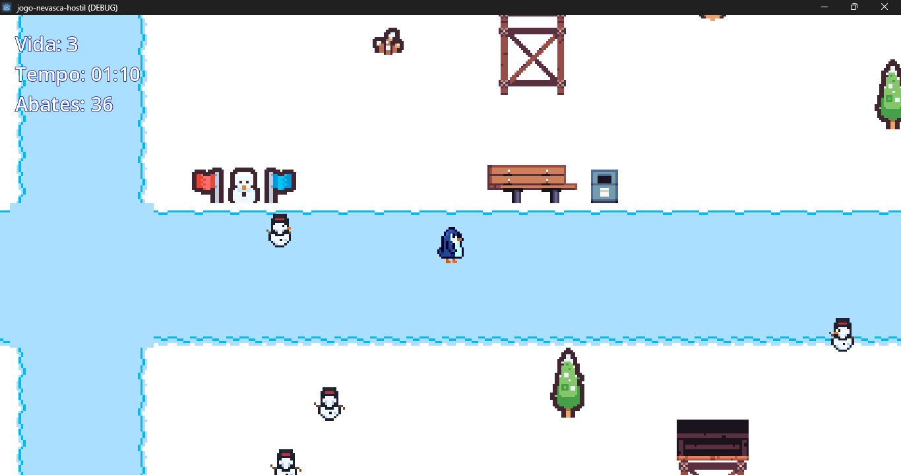
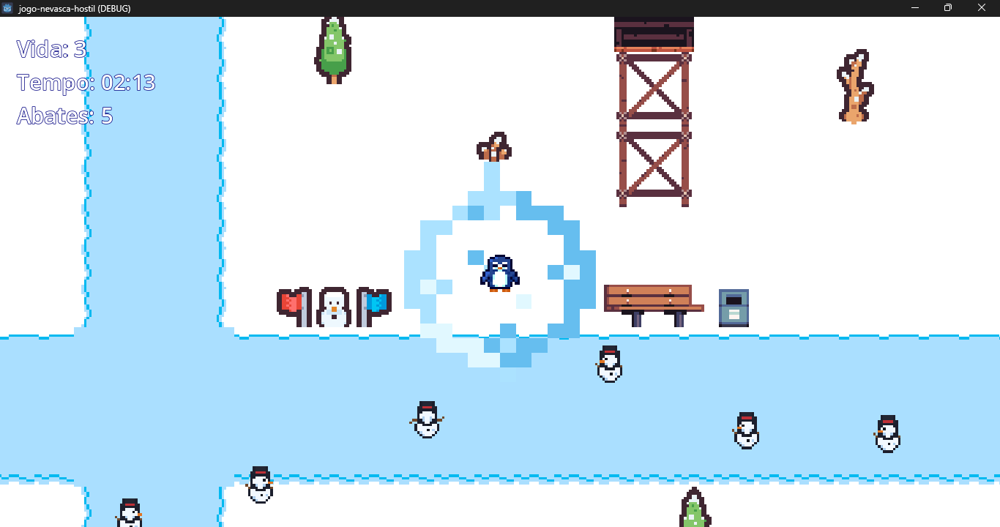
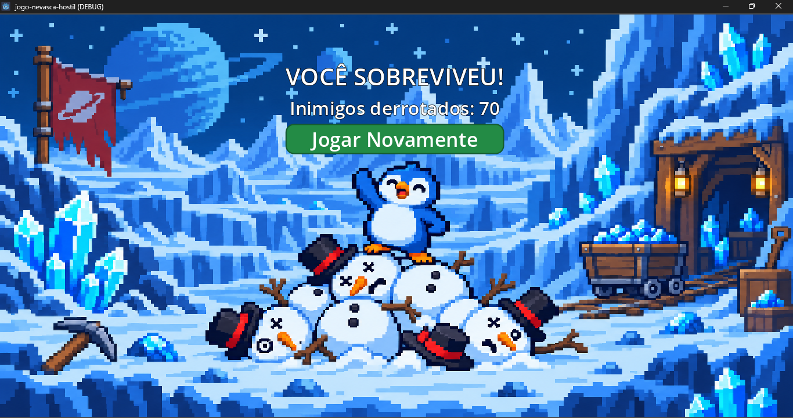
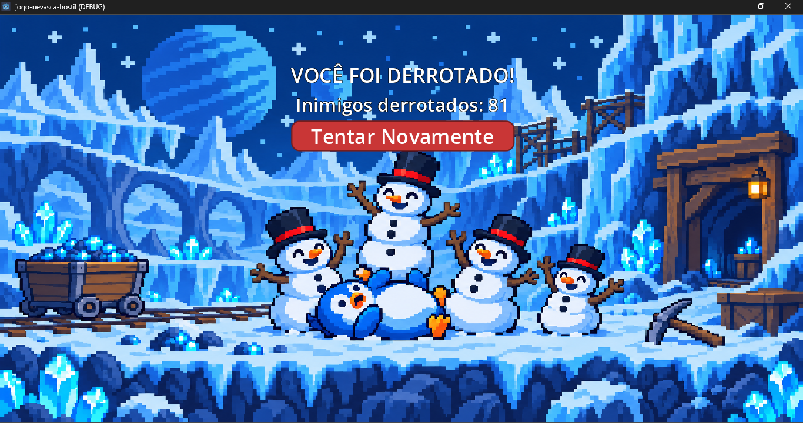

# Planeta de Gelo

**Tema:** Um planeta congelado habitado por bonecos de neve hostis.

**Gênero:** Sobrevivência.

**Perspectiva:** Top-down (visão de cima).

**Objetivo:** Sobreviver por 3 minutos, evitando os bonecos de neve hostis e resistindo aos perigos do ambiente congelado.

## Como jogar

### Controles

- **WASD ou teclas direcionais:** movimentar o personagem.
- **Barra de espaço:** realizar o ataque de onda de gelo.

### Objetivo da partida

- Sobreviva durante 3 minutos para vencer.
- Utilize o ataque de gelo para derrotar os bonecos de neve.
- Evite o contato com os inimigos, pois eles causam dano ao personagem.
- Se perder todos os pontos de vida, a partida termina em derrota.
- Ao final da partida, é possível reiniciar e tentar novamente.

## Capturas de tela

### Gameplay

### Ataque especial

### Tela de vitória

### Tela de derrota

## Créditos e licenças

### GrafxKid

**Pacotes utilizados:**
- Cave Tileset: torres e caixotes.
- Misc Universal Tiles: cadeira e caixa postal/lixeira.

**Licença:** CC0 1.0 Universal Public Domain.

Os recursos podem ser utilizados e modificados livremente.

Licença: https://creativecommons.org/publicdomain/zero/1.0/

### The Ed — Ed's Pixel Winter Pack (Free Demo + Penguin)

**Elementos utilizados:**
- Fences (cercas).
- Frozen Water e Layered Snow: utilizados na composição do chão, caminhos e áreas congeladas.
- Penguin: utilizado como personagem principal.

**Crédito obrigatório:** The Ed (Edoardo Venerandi).

**Licença:** Ed's Pixel Winter Pack — uso permitido em projetos não comerciais, com possibilidade de modificação dos assets. Os recursos não podem ser revendidos ou redistribuídos separadamente, nem apresentados como criação própria.

Os sprites do pinguim possuem condições de uso específicas, permitindo também sua utilização em projetos comerciais, respeitando as restrições de redistribuição.

### Kenney

**Pacotes utilizados:**

**Tiny Dungeon (1.0):**
- Trilhos.
- Baú.
- Vagão.

**Tiny Ski (1.0):**
- Árvores.
- Arbustos.
- Bandeiras.
- Pedra.
- Toco de árvore.
- Boneco de neve decorativo.

**Licença:** Creative Commons Zero (CC0).

Os recursos podem ser utilizados e modificados em projetos pessoais, educacionais e comerciais.

Créditos: Kenney — https://www.kenney.nl

Licença: http://creativecommons.org/publicdomain/zero/1.0/

### Manus AI

**Elementos criados com auxílio da ferramenta:**
- Efeito visual do ataque de onda de gelo.
- Ilustração da tela de vitória.
- Ilustração da tela de derrota.

### OpenAI — ChatGPT

- Sprite do boneco de neve utilizado como inimigo, criado com auxílio do ChatGPT.

## Ferramentas utilizadas

- Godot Engine — desenvolvimento do jogo.
- Manus AI — criação de recursos visuais.
- ChatGPT — auxílio na criação de arte e no desenvolvimento do projeto.
